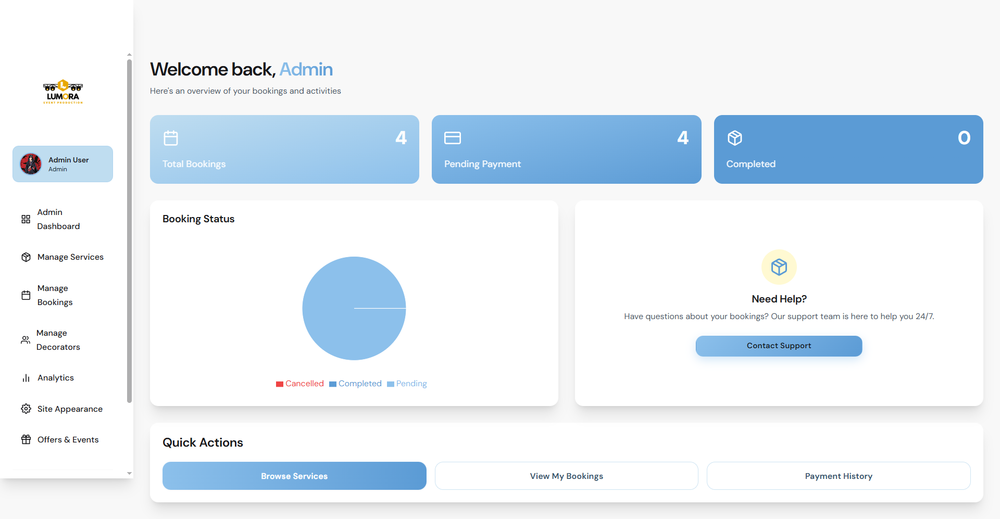
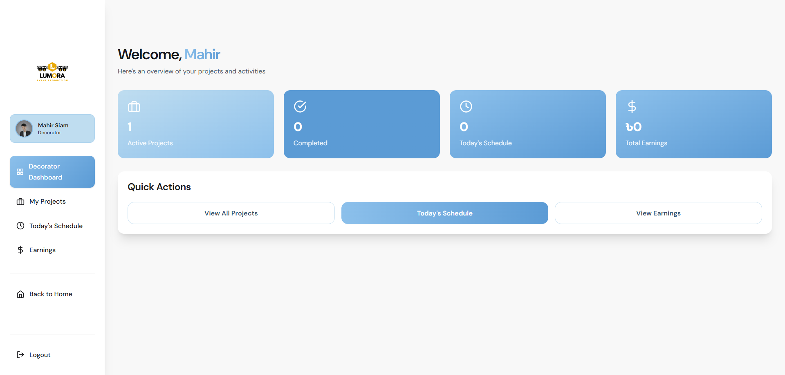
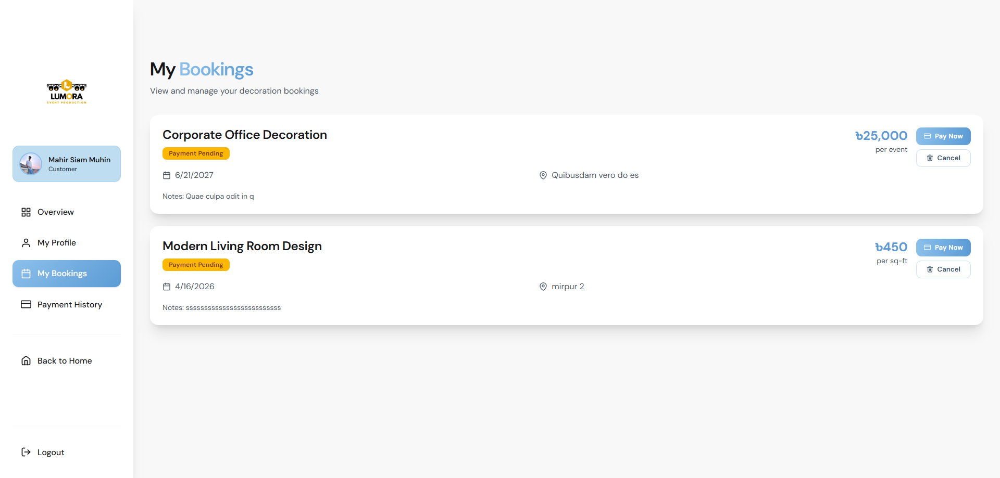
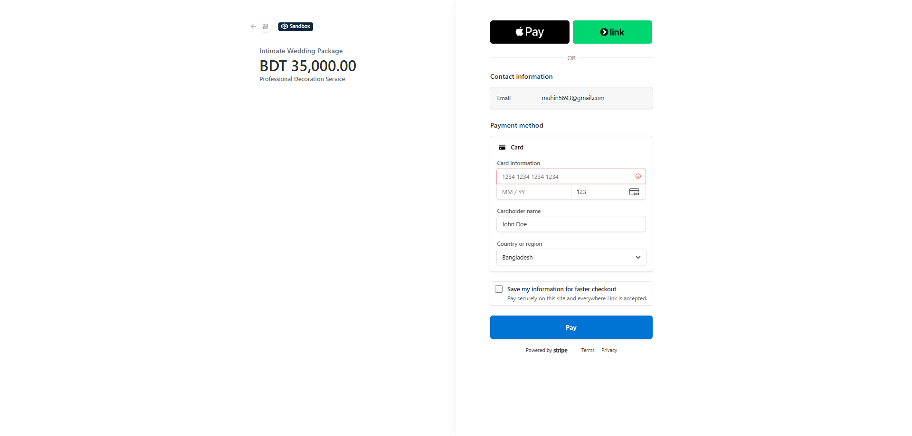
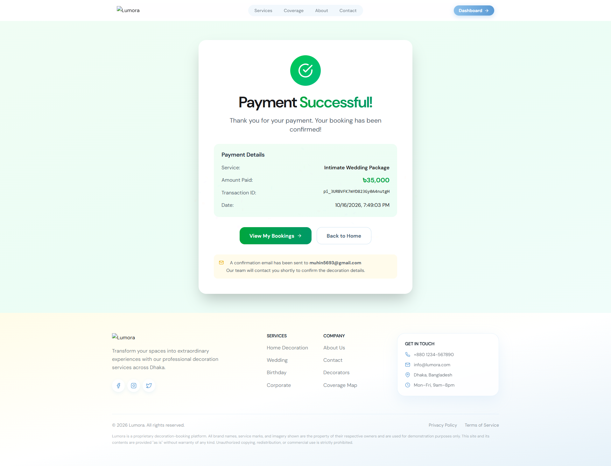

# Lumora

**A decoration booking platform for events and living spaces in Dhaka.**

Lumora connects customers with decorators through a web experience for discovering services, managing bookings, and coordinating projects. This repository contains the frontend application; the backend API is maintained and deployed separately.

## Features

- Browse decoration services and view service coverage.
- Create and manage bookings, with Stripe-powered checkout.
- Role-based dashboards for customers, decorators, and administrators.
- Admin tools for managing services, bookings, decorators, promotions, and platform analytics.
- Firebase Authentication and protected dashboard routes.

## Screenshots

<table>
  <tr>
    <td width="50%" valign="top">
      <strong>Admin dashboard</strong><br>
      
    </td>
    <td width="50%" valign="top">
      <strong>Decorator dashboard</strong><br>
      
    </td>
  </tr>
  <tr>
    <td width="50%" valign="top">
      <strong>Customer bookings</strong><br>
      
    </td>
    <td width="50%" valign="top">
      <strong>Stripe checkout</strong><br>
      
    </td>
  </tr>
  <tr>
    <td colspan="2" align="center">
      <strong>Payment confirmation</strong><br>
      
    </td>
  </tr>
</table>

## Tech stack

React 19, Vite, React Router, Tailwind CSS, Firebase Authentication, Axios, Stripe, and Recharts.

## Run locally

```bash
npm install
npm run dev
```

Configure a `.env` file with `VITE_API_URL`, `VITE_IMAGEBB_API_KEY`, and the Firebase settings: `VITE_FIREBASE_API_KEY`, `VITE_FIREBASE_AUTH_DOMAIN`, `VITE_FIREBASE_PROJECT_ID`, `VITE_FIREBASE_STORAGE_BUCKET`, `VITE_FIREBASE_MESSAGING_SENDER_ID`, and `VITE_FIREBASE_APP_ID`. A working backend API and Firebase project are required for application features that use authentication and server data. Do not commit environment files or secret values.

Useful commands:

```bash
npm run build    # Create a production build
npm run preview  # Preview the production build locally
npm run lint     # Run ESLint
```

## Creator

**Mahir Siam** · [mahirsiam2004@gmail.com](mailto:mahirsiam2004@gmail.com)

---

Proprietary. All rights reserved.
